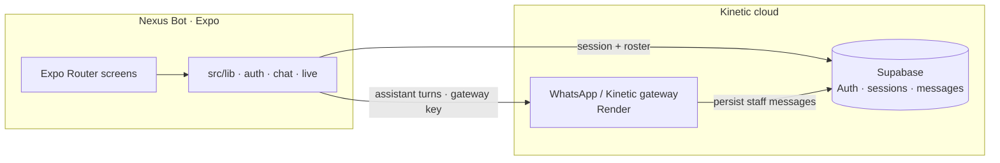
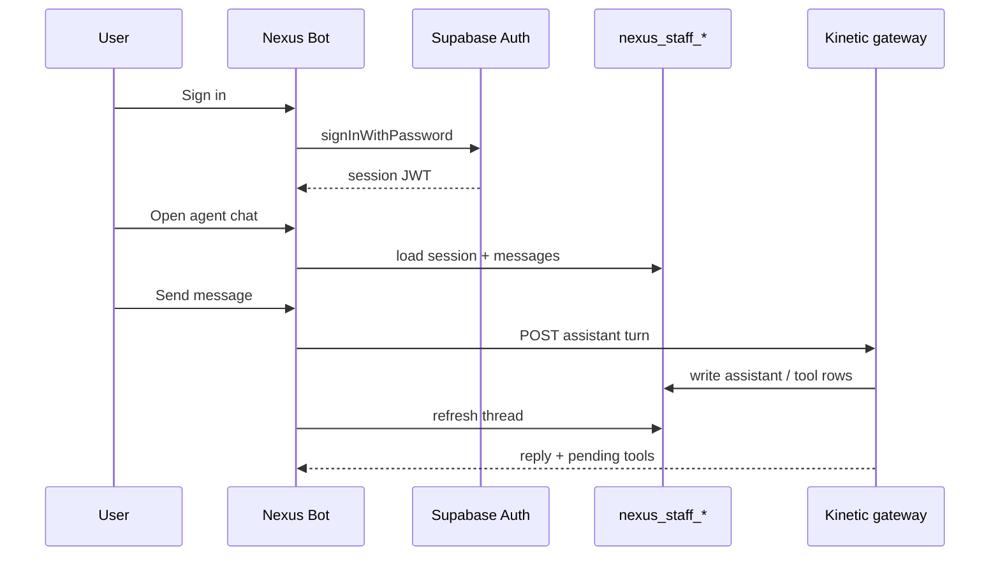
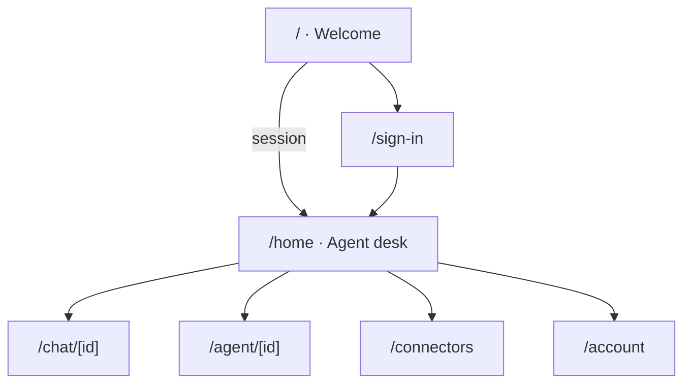
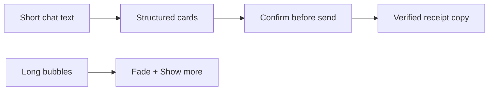

<div align="center">

# Nexus Bot

**Your team of always-on agents that finish the work.**

The Kinetic mobile client — chat with Nexus and specialist agents, manage connectors, and stay linked to the same workspace that powers the web dashboard and WhatsApp gateway.

[](https://docs.expo.dev/)
[](https://reactnative.dev/)
[](https://www.typescriptlang.org/)
[](https://docs.expo.dev/eas/)
[](./LICENSE)

[Features](#-features) · [Architecture](#-architecture) · [Screens](#-app-map) · [Setup](#-getting-started) · [Env](#-environment) · [Build](#-eas-builds) · [Docs](#-docs)

</div>

---

> [!NOTE]
> Nexus Bot is the **mobile surface** of Kinetic. Auth and agent sessions live in **Supabase**. Chat turns, tools, and WhatsApp commerce run through the **Kinetic gateway** (`aura-chat` / `kinetic-gateway`).

## ✨ Features

| Area | What you get |
| --- | --- |
| **Agent desk** | Home roster of Nexus + specialist agents, with live activity |
| **Console chat** | Streaming-style turns, thinking lines, tool chips, collapsible long replies |
| **Connectors** | WhatsApp and channel marks wired to the Kinetic workspace |
| **Account** | Kinetic email/password sign-in via Supabase Auth |
| **Appearance** | Light / dark / system, ink tokens, glass-friendly layout |
| **Ship path** | Expo Router, EAS Build channels, OTA updates |

## 🏗 Architecture





### Stack

| Layer | Choice |
| --- | --- |
| Runtime | Expo ~58 · React 19 · React Native 0.88 |
| Navigation | Expo Router (file routes under `src/app`) |
| Data | `@supabase/supabase-js` |
| Motion / UI | Reanimated · Gesture Handler · Keyboard Controller · SVG |
| Ship | EAS Build + `expo-updates` |
| Package manager | npm |

## 🗺 App map



| Route | Role |
| --- | --- |
| `src/app/index.tsx` | Welcome + session bootstrap |
| `src/app/sign-in.tsx` | Kinetic account login |
| `src/app/home.tsx` | Agent desk / team |
| `src/app/chat/[id].tsx` | Staff console chat |
| `src/app/agent/[id].tsx` | Agent profile |
| `src/app/connectors.tsx` | Connector roster |
| `src/app/account.tsx` | Account + appearance |

<details>
<summary><strong>Source layout</strong></summary>

```text
nexus-bot/
├─ src/
│  ├─ app/                 # Expo Router screens
│  ├─ components/          # Chat UI, Bloub, connectors, console
│  ├─ constants/theme.ts   # Design tokens
│  ├─ hooks/               # Color scheme + theme
│  └─ lib/                 # Auth, Supabase, chat, live, account
├─ assets/                 # Icons, splash, connectors, Bloub
├─ docs/                   # Product notes
├─ app.json / app.config.ts
├─ eas.json
└─ .env.example
```

</details>

## 🚀 Getting started

> [!TIP]
> Use **Node 22+** and a development build when you add native modules Expo Go does not ship. Prefer `npx expo install` so versions stay SDK-aligned.

### 1. Clone

```bash
git clone https://github.com/Auwanga/nexus-bot.git
cd nexus-bot
```

### 2. Install

```bash
npm install
```

### 3. Environment

```bash
cp .env.example .env
```

Fill the values (see [Environment](#-environment)), then start Metro:

```bash
npx expo start
```

| Command | Purpose |
| --- | --- |
| `npm start` / `npx expo start` | Dev server |
| `npm run ios` | iOS simulator |
| `npm run android` | Android emulator |
| `npm run web` | Web |
| `npm run lint` | Expo lint |
| `npx tsc --noEmit` | Typecheck |

## 🔐 Environment

| Variable | Required | Description |
| --- | --- | --- |
| `EXPO_PUBLIC_SUPABASE_URL` | yes | Supabase project URL |
| `EXPO_PUBLIC_SUPABASE_ANON_KEY` | yes | Publishable / anon key |
| `EXPO_PUBLIC_GATEWAY_URL` | yes | Kinetic gateway base URL (e.g. `https://kinetic-gateway.onrender.com`) |
| `EXPO_PUBLIC_GATEWAY_KEY` | recommended | Matches `GATEWAY_API_KEY` on the gateway |

`app.config.ts` copies these into `expo.extra` so native builds pick them up at build time.

> [!IMPORTANT]
> Never commit `.env` or `.env.local`. Only `.env.example` is tracked. Rotate any key that was pasted into chat or screenshots.

## 📦 EAS builds

Profiles in [`eas.json`](./eas.json):

| Profile | Channel | Notes |
| --- | --- | --- |
| `development` | `development` | Dev client, internal |
| `preview` | `preview` | Internal distribution |
| `production` | `production` | Store / production + autoIncrement |

```bash
npx eas-cli@latest login
npx eas-cli@latest build --profile development --platform ios
npx eas-cli@latest build --profile preview --platform android
npx eas-cli@latest update --channel production --message "Describe the OTA"
```

Bundle IDs:

- iOS · `com.kinetic.nexusbot`
- Android · `com.kinetic.nexusbot`
- Scheme · `nexusbot://`

## 🎨 Design notes

Mobile UI rules live in [`19_MOBILE_UI_DESIGN.md`](./19_MOBILE_UI_DESIGN.md). Reference onboarding frames are under `Grok Bot iOS Onboarding/`.



| Principle | Practice |
| --- | --- |
| Chat-first | Desk → agent → console; no CRM wizard shell |
| Calm ink | Neutral surfaces, one accent, system fonts |
| Safe actions | Confirm cards before outbound / destructive work |
| Offline-friendly tokens | Bundled assets; no remote font CDNs required |

## 🔗 Related Kinetic repos

| Repo / service | Role |
| --- | --- |
| [`aura-chat`](https://github.com/Auwanga/aura-chat) | Web app + WhatsApp / SMS gateway |
| Supabase (`enkaliprime-agents`) | Auth, businesses, `nexus_staff_*` |
| Render `kinetic-gateway` | Production messaging + assistant API |

## 📚 Docs

- [Expo Router](https://docs.expo.dev/router/introduction/)
- [EAS Build](https://docs.expo.dev/build/introduction/)
- [EAS Update](https://docs.expo.dev/eas-update/introduction/)
- [Supabase Auth](https://supabase.com/docs/guides/auth)
- Local: [`AGENTS.md`](./AGENTS.md) · [`docs/account-portraits.md`](./docs/account-portraits.md)

## ✅ Checklist before first run

- [ ] `.env` filled from `.env.example`
- [ ] Supabase Auth allows email/password for Kinetic accounts
- [ ] Gateway `/health` returns `ok: true` and accepts your gateway key
- [ ] At least one staff agent session exists for the signed-in business
- [ ] `npx expo start` opens Welcome → Sign in → Home

## 🛡 Security

> [!CAUTION]
> The anon key and gateway key in the app are **client-visible**. Protect data with Supabase RLS and gateway auth. Do not put service-role keys in Expo public env vars.

## 📄 License

MIT — see [`LICENSE`](./LICENSE).

---

<div align="center">

Built for **Kinetic** · EnkaliPrime

</div>
